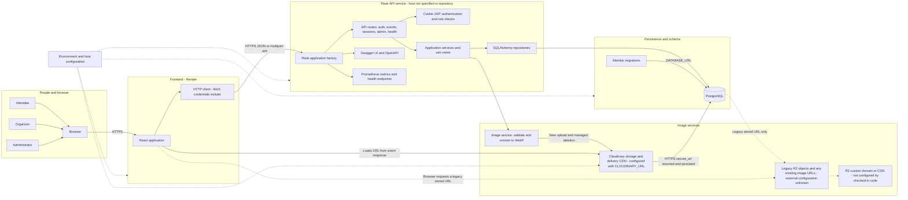
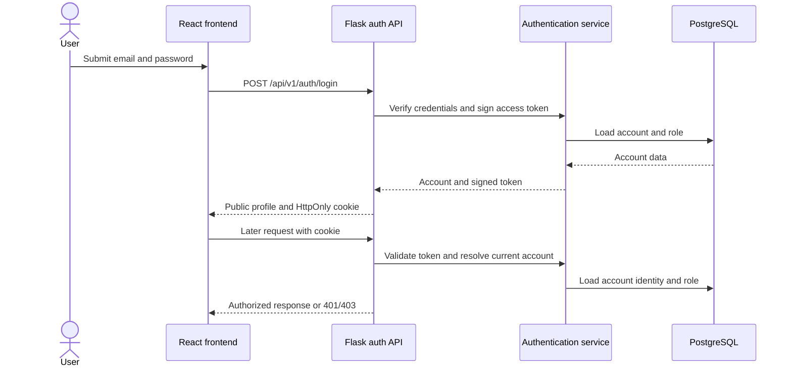
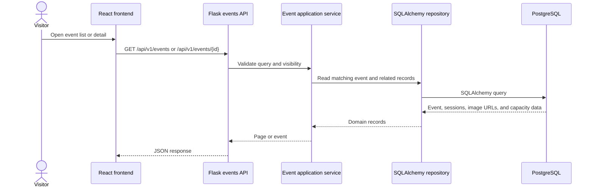
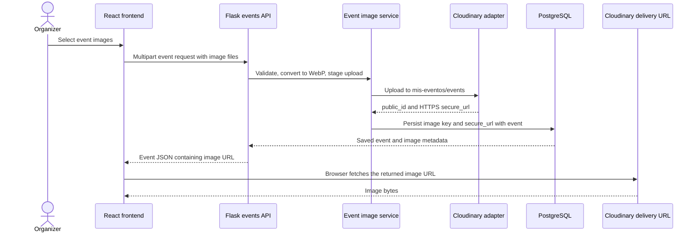

# Mis Eventos architecture

This document describes the architecture represented by the checked-in
application code. The production frontend URL is known; the public backend URL,
database provider, and any project-specific Cloudflare R2/CDN configuration are
not present in this repository and are not inferred here.

## System overview

The production frontend is
[`https://mis-eventos-frontend-h2j3.onrender.com/`](https://mis-eventos-frontend-h2j3.onrender.com/).
The frontend is a React application built with Vite. Its HTTP client uses
`VITE_API_BASE_URL` and sends cookie credentials. In local development, Vite
proxies `/api` using `API_PROXY_TARGET`; that proxy is not used by the deployed
static frontend.

The repository does not include the production backend's public hostname or a
host-specific deployment manifest. Set the production frontend's
`VITE_API_BASE_URL` to that backend's HTTPS URL ending in `/api/v1`. The backend
Swagger UI path is `/apidocs/` and its OpenAPI document is `/apispec_1.json`;
the corresponding public URLs are the backend host plus those paths, but the
host itself cannot be confirmed from this repository.

### Backend responsibilities

The Flask application factory registers API route groups and wires request
services. Routes handle HTTP input and output; application services apply use
cases; repositories persist data through SQLAlchemy. The main areas are:

- **Authentication:** registration, login, logout, and the current-user profile.
- **Events:** public event browsing, organizer event management, event images,
  event registration, capacity, and recommendations.
- **Sessions:** event schedules, session attendance, and session capacity.
- **Administration:** user directory, attendee-to-organizer promotion, and
  aggregate dashboard data.
- **Health and observability:** liveness, readiness, health, and `/metrics`.

Prometheus metrics are exposed by the backend process. No metrics collector or
browser telemetry ingestion service is configured by this repository.

## Data and migrations

PostgreSQL stores user accounts and roles, events and ownership, sessions,
speakers and associations, event and session registrations, and image metadata
(storage key, URL, and display position). Capacity and duplicate-registration
constraints are enforced by the application and database constraints.

Alembic migration files under `backend/migrations/versions/` evolve the schema.
Alembic imports SQLAlchemy model metadata and connects through `DATABASE_URL`.
The deployment guide recommends applying `poetry run alembic upgrade head` as a
release step against the same database URL used by the backend. The repository
does not identify the production database provider or supply production
credentials.

## Authentication and authorization

Registration creates an attendee account. Login verifies the account and sets
an expiring `HttpOnly` access-token cookie scoped to `/api/v1`; the browser
client includes cookies on API requests. In production, `APP_ENVIRONMENT` must
be `production`, `JWT_COOKIE_SECURE` must be `true`, and `JWT_SECRET_KEY` must
be configured with at least 32 bytes. When `FRONTEND_ORIGIN` is set with secure
cookies, the cookie uses `SameSite=None` for cross-origin browser requests.
Without a configured frontend origin, CORS is not enabled by this app.

The backend validates the token and resolves the current account before
role-protected actions. Role checks are enforced in backend routes and
ownership checks are applied by event and session services:

| Role | Confirmed capabilities |
| --- | --- |
| Attendee | Browse published events, register/cancel event attendance, enroll/cancel session attendance, view own registrations and profile. |
| Organizer | Create and manage owned events and sessions; review attendees and registrations for owned events. |
| Administrator | Access administrative user and aggregate views, promote attendees to organizer, and perform event/session management with administrator authorization. |

Publicly available event and capacity reads do not require an account. The
backend remains the authorization boundary even when the frontend hides
restricted controls.

## Event and image request flows

### Authentication

The cookie is not returned as profile data. Logout expires the cookie in the
browser. Authorization decorators and domain service checks run on protected
requests.

### Event query

Registration and session enrollment use the authenticated account ID rather
than accepting an arbitrary user ID. Capacity endpoints report occupied and
available places; application services and database constraints protect
registration state.

### New event image upload and delivery

For new uploads, code uses `CLOUDINARY_URL`; it does not configure Cloudflare
R2. Existing image records can retain prior R2 URLs and are returned as stored.
The browser fetches those URLs directly, but this repository does not define
their R2 bucket, credentials, endpoint, custom domain, or CDN. No specific
Cloudflare image delivery service can therefore be confirmed from the code.

## Configuration and environments

The following names are read by the checked-in code or documented deployment
flow. Secret values belong in private backend host settings, never in frontend
build variables.

| Variable | Scope | Requirement and purpose |
| --- | --- | --- |
| `DATABASE_URL` | Backend and Alembic | Required for production database access and migrations. |
| `JWT_SECRET_KEY` | Backend | Required for authentication/readiness; at least 32 bytes. |
| `APP_ENVIRONMENT` | Backend | Set to `production` for deployment validation. |
| `JWT_COOKIE_SECURE` | Backend | Must be `true` in production. |
| `FRONTEND_ORIGIN` | Backend | Set to the exact frontend origin for direct cross-origin browser access and credentialed CORS. |
| `JWT_ACCESS_TOKEN_TTL_SECONDS` | Backend | Optional positive lifetime; default is 3600 seconds. |
| `PORT` | Backend host | Platform-provided listening port; default is 5000. |
| `WEB_CONCURRENCY` | Backend host | Optional Gunicorn worker count; default is 2. |
| `VITE_API_BASE_URL` | Frontend build | Public API base compiled into the bundle. Defaults to `/api/v1`; set to the public backend API URL for separate hosts. |
| `VITE_APP_ENVIRONMENT`, `VITE_APP_VERSION` | Frontend build | Optional public telemetry labels. |
| `CLOUDINARY_URL` | Backend secret | Optional at startup; needed for new image uploads and cleanup of managed Cloudinary assets. |
| `API_PROXY_TARGET` | Vite development server | Optional local proxy target; Compose points it to `http://backend:5000`. It does not route production frontend traffic. |

The code defines no Cloudflare R2 credential, endpoint, bucket, or CDN
environment variable. R2-related infrastructure may exist outside this
repository, but its values and relationship to production image URLs are not
confirmed here.

For local development, create `.env` from `.env.example`, set a private local
`JWT_SECRET_KEY`, and run `make setup`, `make run`, and `make status` from the
repository root. Compose runs PostgreSQL, the backend, and the Vite frontend;
its internal API and database service ports remain separate from host-published
ports. See [local development instructions](../README.md#local-development-commands),
the [backend guide](../backend/README.md), and the
[production deployment guide](deployment.md) for operational details.

## Confirmed versus external configuration

| Component | Status in this repository |
| --- | --- |
| React/Vite frontend URL | Confirmed as `https://mis-eventos-frontend-h2j3.onrender.com/` for documentation. |
| Frontend hosting provider | The supplied production URL is on Render; no deployment manifest is checked in. |
| Public backend URL and provider | Not found in checked-in configuration. Configure via deployment settings. |
| Swagger | Flask registers the UI at `/apidocs/` and OpenAPI JSON at `/apispec_1.json`; public host is unknown. |
| PostgreSQL provider | Not specified. Backend and Alembic use `DATABASE_URL`. |
| New image storage/delivery | Cloudinary adapter and returned HTTPS URL are implemented. Production credentials/configuration are not present in this repository; the setting is optional at startup. |
| Existing R2 image URLs | Preserved as image metadata and returned to the frontend; no current R2 upload integration is configured. |
| Cloudflare R2 bucket/CDN configuration | Not present in checked-in source or deployment configuration. |
